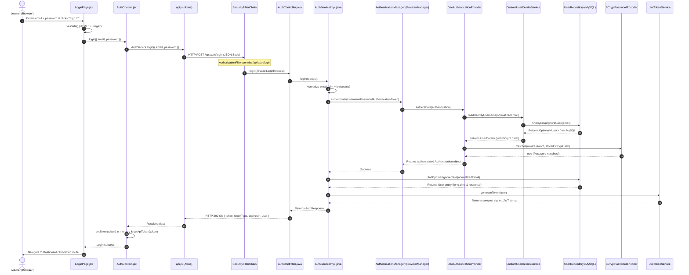
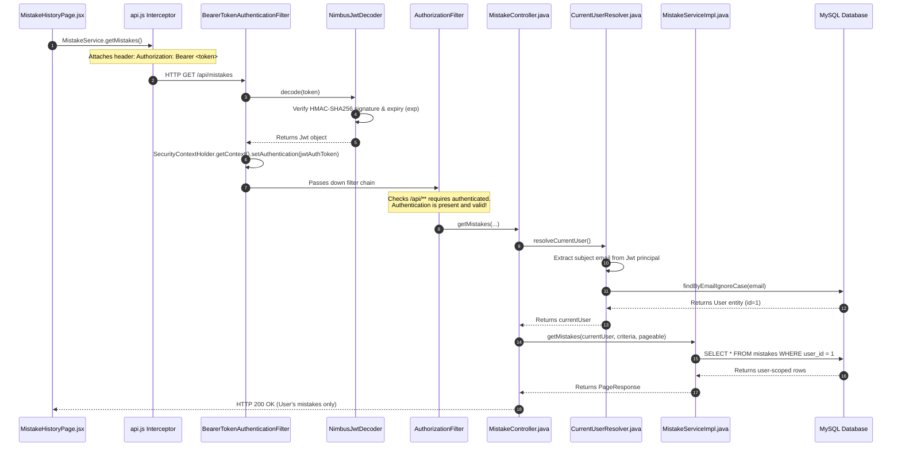

# Complete Spring Security Login & Authentication Flow: Line-by-Line Debugging Guide

This document traces the complete execution flow of authentication in **Daily DSA Mistake Log**—from the moment a user clicks **Login** on the React frontend to backend Spring Security filter chains, MySQL query execution, BCrypt password verification, Nimbus JWT generation, and downstream authentication of protected API endpoints.

---

## 1. Authentication Architecture & Source File Map

The application uses a **stateless REST architecture** with **Spring Security 6**, **OAuth2 Resource Server (Nimbus JWT)**, and an **in-memory token React client**.

```
DailyDSAMistakeLog/
├── frontend/src/
│   ├── pages/LoginPage.jsx                     # Login UI form, client validation, submit handler
│   ├── context/AuthContext.jsx                 # In-memory auth state (token, user, login, logout)
│   ├── services/api.js                         # Centralized Axios client with Bearer interceptor & 401 callback
│   └── components/ProtectedRoute.jsx           # Route guard checking in-memory auth state
└── backend/src/main/java/com/dsa/mistakelog/
    ├── config/
    │   ├── SecurityConfig.java                 # SecurityFilterChain, PasswordEncoder, AuthenticationManager, JwtDecoder/Encoder
    │   ├── CustomUserDetailsService.java       # UserDetailsService implementation loading User from MySQL
    │   ├── JwtTokenService.java                # Signs HMAC-SHA256 JWT with claims (userId, email, role, etc.)
    │   └── CurrentUserResolver.java            # Resolves authenticated User from SecurityContextHolder
    ├── controller/
    │   └── AuthController.java                 # REST Controller exposing POST /api/auth/login and /register
    ├── service/
    │   ├── AuthService.java                    # Authentication service interface
    │   └── AuthServiceImpl.java                # Delegates to AuthenticationManager, checks DB, requests JWT
    ├── repository/
    │   └── UserRepository.java                 # Spring Data JPA repository (findByEmailIgnoreCase)
    ├── entity/
    │   └── User.java                           # JPA Entity mapped to `users` table
    ├── dto/
    │   ├── LoginRequest.java                   # Validated payload: { email, password }
    │   └── AuthResponse.java                   # Response payload: { token, tokenType, expiresIn, user }
    └── exception/
        └── GlobalExceptionHandler.java         # Maps BadCredentialsException to 401 JSON
```

### Key Architectural Discovery
* **No `UsernamePasswordAuthenticationFilter` is used for login**: The application does **not** use Spring Security's legacy form-login filter (`http.formLogin()`). 
* Instead, it implements a **Controller-Driven REST Authentication Flow**:
  1. The login endpoint (`POST /api/auth/login`) is marked `.permitAll()` in `SecurityConfig`.
  2. The HTTP request passes unhindered through the filter chain to `AuthController.login()`.
  3. `AuthServiceImpl` explicitly delegates credential verification to `AuthenticationManager.authenticate(...)`.
  4. Once authenticated, `JwtTokenService` generates a signed JWT access token.
  5. Subsequent protected requests (`/api/mistakes`, `/api/learn/progress`, etc.) are intercepted and authenticated by Spring Security's `BearerTokenAuthenticationFilter`.

---

## 2. High-Level Login Call Chain



---

## 3. Step-by-Step Line-by-Line Execution Flow

### Step 1: User Clicks "Sign In" (Frontend)
* **File**: `frontend/src/pages/LoginPage.jsx`
* **Line 126**: The `<form onSubmit={handleSubmit} noValidate>` intercepts submission.
* **Lines 58–61**:
  ```javascript
  const handleSubmit = async (e) => {
    e.preventDefault();
    if (!validate()) return;
  ```
  `validate()` (lines 42–56) verifies non-empty email, valid regex format (`/^[^\s@]+@[^\s@]+\.[^\s@]+$/`), and non-empty password.
* **Lines 66–69**:
  ```javascript
  await login({
    email: formData.email.trim(),
    password: formData.password
  });
  ```

### Step 2: In-Memory State & Axios Dispatch
* **File**: `frontend/src/context/AuthContext.jsx`
* **Lines 25–33**:
  ```javascript
  const login = async ({ email, password }) => {
    const data = await AuthService.login({ email, password });
    if (data?.token) {
      setToken(data.token);      // In React state (Defense-in-depth: NOT in localStorage)
      setApiToken(data.token);   // In Axios closure for future Authorization headers
      setUser(data.user);
    }
    return data;
  };
  ```
* **File**: `frontend/src/services/api.js`
* **Lines 92–95**:
  ```javascript
  login: async (credentials) => {
    const response = await apiClient.post('/auth/login', credentials);
    return response.data;
  }
  ```
* **HTTP Transmission**:
  * **Method**: `POST`
  * **URL**: `http://localhost:8080/api/auth/login`
  * **Headers**: `Content-Type: application/json`, `Accept: application/json`
  * **Body**: `{"email":"learner@example.com","password":"MyPassword123"}`

---

### Step 3: Spring Security Filter Chain Traversal
When the HTTP request reaches Spring Boot on port 8080, it enters the `FilterChainProxy`.

#### Filter Chain Execution Order for `POST /api/auth/login`:
| # | Filter Class | Action Taken on `/api/auth/login` |
|---|---|---|
| 1 | `DisableEncodeUrlFilter` | Disables URL session-id rewriting. |
| 2 | `WebAsyncManagerIntegrationFilter` | Binds async web execution contexts. |
| 3 | `SecurityContextHolderFilter` | Loads current `SecurityContext` (initially unauthenticated). |
| 4 | `HeaderWriterFilter` | Adds standard defensive HTTP headers. |
| 5 | `CorsFilter` | Validates `Origin` against `app.cors.allowed-origins` (`http://localhost:5173`). Passes through. |
| 6 | `LogoutFilter` | Checks if URL matches `/logout`. Does not match; passes through. |
| 7 | `BearerTokenAuthenticationFilter` | Checks `Authorization: Bearer <token>`. Header is absent on login; filter passes through without action. |
| 8 | `RequestCacheAwareFilter` | Checks saved redirect requests. |
| 9 | `SecurityContextHolderAwareRequestFilter` | Wraps request with servlet security wrappers. |
| 10 | `AnonymousAuthenticationFilter` | Populates `SecurityContext` with `AnonymousAuthenticationToken("anonymousUser")`. |
| 11 | `ExceptionTranslationFilter` | Catches unhandled security exceptions downstream. |
| 12 | `AuthorizationFilter` | Inspects `SecurityConfig.java:100`. Rule: `.requestMatchers(HttpMethod.POST, "/api/auth/register", "/api/auth/login").permitAll()`. Match found! **Request is permitted to proceed.** |

---

### Step 4: Controller Invocation & DTO Validation
* **File**: `backend/src/main/java/com/dsa/mistakelog/controller/AuthController.java`
* **Lines 28–31**:
  ```java
  @PostMapping("/login")
  public ResponseEntity<AuthResponse> login(@Valid @RequestBody LoginRequest request) {
      AuthResponse response = authService.login(request);
      return ResponseEntity.ok(response);
  }
  ```
* Spring MVC maps incoming JSON to `LoginRequest`:
  * `@NotBlank` and `@Email` are evaluated by Jakarta Hibernate Validator.
  * If validation fails: `GlobalExceptionHandler.handleValidationExceptions` intercepts and returns `400 Bad Request`.
  * If valid: execution transfers to `AuthServiceImpl.login(request)`.

---

### Step 5: Email Normalization & AuthenticationManager Invocation
* **File**: `backend/src/main/java/com/dsa/mistakelog/service/AuthServiceImpl.java`
* **Lines 54–60**:
  ```java
  @Override
  @Transactional(readOnly = true)
  public AuthResponse login(LoginRequest request) {
      String normalizedEmail = request.getEmail().trim().toLowerCase();

      try {
          authenticationManager.authenticate(
                  new UsernamePasswordAuthenticationToken(normalizedEmail, request.getPassword())
          );
      } catch (AuthenticationException e) { ... }
  ```
* An **unauthenticated** `UsernamePasswordAuthenticationToken` is created:
  * `principal`: `"learner@example.com"`
  * `credentials`: `"MyPassword123"`
  * `authenticated`: `false`

---

### Step 6: AuthenticationManager & DaoAuthenticationProvider
* `AuthenticationManager` is implemented by Spring Security's `ProviderManager`.
* `ProviderManager.authenticate()` iterates over its configured providers:
  1. It invokes `DaoAuthenticationProvider.authenticate(authentication)`.
  2. `DaoAuthenticationProvider.retrieveUser(username, token)` executes.
  3. It invokes our custom bean: `CustomUserDetailsService.loadUserByUsername(normalizedEmail)`.

---

### Step 7: MySQL Lookup (Spring Data JPA)
* **File**: `backend/src/main/java/com/dsa/mistakelog/config/CustomUserDetailsService.java`
* **Lines 26–33**:
  ```java
  User user = userRepository.findByEmailIgnoreCase(email.trim())
          .orElseThrow(() -> new UsernameNotFoundException("User not found with email: " + email));

  return org.springframework.security.core.userdetails.User.builder()
          .username(user.getEmail())
          .password(user.getPassword())
          .authorities(Collections.singletonList(new SimpleGrantedAuthority("ROLE_" + user.getRole().name())))
          .build();
  ```
* **SQL Query Executed in MySQL**:
  ```sql
  SELECT u.id, u.name, u.email, u.password, u.role, u.created_at, u.updated_at 
  FROM users u 
  WHERE UPPER(u.email) = UPPER('learner@example.com');
  ```
* **Outcome**:
  * **If user does not exist**: Throws `UsernameNotFoundException`. `DaoAuthenticationProvider` intercepts this and throws `BadCredentialsException` (preventing email enumeration).
  * **If user exists**: Returns `UserDetails` containing the user's stored BCrypt hash (e.g., `$2a$10$7Q...`).

---

### Step 8: Password Verification Line by Line (BCrypt)
* `DaoAuthenticationProvider` calls its internal method:
  ```java
  additionalAuthenticationChecks(userDetails, (UsernamePasswordAuthenticationToken) authentication);
  ```
* This method executes:
  ```java
  if (!this.passwordEncoder.matches(presentedPassword, userDetails.getPassword())) {
      throw new BadCredentialsException("Bad credentials");
  }
  ```
* **File**: `backend/src/main/java/com/dsa/mistakelog/config/SecurityConfig.java`
* **Lines 52–54**:
  ```java
  @Bean
  public PasswordEncoder passwordEncoder() {
      return new BCryptPasswordEncoder();
  }
  ```

#### How `BCryptPasswordEncoder.matches(rawPassword, storedHash)` Works Internally:
1. **Never uses `.equals()`**: BCrypt hashes use a random 16-byte salt generated during registration. Two encodings of the same password yield completely different strings:
   ```
   Registration 1: $2a$10$vI8aWBnW3fID.ZQ4/zo1G.q1lRps.9cGLcZEiGDMVr5yUP1KUOYTa
   Registration 2: $2a$10$e8w.8eG0y0DkKk0X2q9qTe0K1G3bC7m9L1Z5X6V8M2N4Q7R9T1U2W
   ```
2. **Salt Extraction**: BCrypt reads the salt bytes directly from the stored hash string (`$2a$10$[22-character salt]...`).
3. **Hashing**: It computes `BCrypt.hashpw(rawPassword, extractedSalt)` using the extracted cost factor ($2^{10} = 1024$ rounds).
4. **Constant-Time Comparison**: It compares the newly derived hash with the stored hash using a constant-time comparison loop to prevent timing attacks.
5. **Outcome**:
   * **Match**: Returns `true`. `DaoAuthenticationProvider` constructs an authenticated `UsernamePasswordAuthenticationToken` with `isAuthenticated() = true` and `ROLE_USER`.
   * **Mismatch**: Throws `BadCredentialsException("Bad credentials")`.

---

### Step 9: JWT Generation
* **File**: `backend/src/main/java/com/dsa/mistakelog/service/AuthServiceImpl.java`
* **Lines 67–78**:
  ```java
  User user = userRepository.findByEmailIgnoreCase(normalizedEmail)
          .orElseThrow(() -> new BadCredentialsException("Invalid email or password"));

  String token = jwtTokenService.generateToken(user);
  log.info("Successful login for user email: {}", user.getEmail());

  return AuthResponse.builder()
          .token(token)
          .tokenType("Bearer")
          .expiresIn(jwtTokenService.getExpirationSeconds())
          .user(UserResponse.fromEntity(user))
          .build();
  ```
* **File**: `backend/src/main/java/com/dsa/mistakelog/config/JwtTokenService.java`
* **Lines 26–42**:
  ```java
  public String generateToken(User user) {
      Instant now = Instant.now();
      Instant expiresAt = now.plusSeconds(expirationSeconds); // 86400s (24 hours)

      JwtClaimsSet claims = JwtClaimsSet.builder()
              .issuer("dsa-mistake-log")
              .issuedAt(now)
              .expiresAt(expiresAt)
              .subject(user.getEmail())
              .claim("userId", user.getId())
              .claim("name", user.getName())
              .claim("role", user.getRole().name())
              .build();

      JwsHeader header = JwsHeader.with(MacAlgorithm.HS256).build();
      return jwtEncoder.encode(JwtEncoderParameters.from(header, claims)).getTokenValue();
  }
  ```

#### Structure of the Resulting JWT:
A standard compact JWT consists of three Base64URL-encoded JSON segments separated by dots (`.`):
$$\text{JWT} = \text{Header} \,.\, \text{Payload} \,.\, \text{Signature}$$

1. **Header (Decoded)**:
   ```json
   {
     "alg": "HS256",
     "typ": "JWT"
   }
   ```
2. **Payload / Claims (Decoded Sanitized Example)**:
   ```json
   {
     "iss": "dsa-mistake-log",
     "sub": "learner@example.com",
     "iat": 1729440000,
     "exp": 1729526400,
     "userId": 1,
     "name": "Jane Developer",
     "role": "USER"
   }
   ```
3. **Signature**:
   $$\text{HMAC-SHA256}(\text{Base64Url}(\text{Header}) + "." + \text{Base64Url}(\text{Payload}), \text{SecretKey})$$

---

### Step 10: Frontend Stores Token & Redirects
* The backend returns HTTP `200 OK` with JSON:
  ```json
  {
    "token": "eyJhbGciOiJIUzI1NiIsInR5cCI6IkpXVCJ9...",
    "tokenType": "Bearer",
    "expiresIn": 86400,
    "user": {
      "id": 1,
      "name": "Jane Developer",
      "email": "learner@example.com",
      "role": "USER"
    }
  }
  ```
* **File**: `frontend/src/context/AuthContext.jsx`:
  * `setToken(data.token)`: Updates React state. `isAuthenticated` becomes `true`.
  * `setApiToken(data.token)`: Configures the Axios client in `api.js`.
  * `setUser(data.user)`: Stores the user profile for display in the navbar and profile page.
* **File**: `frontend/src/pages/LoginPage.jsx:25–29`:
  * `useEffect` observes `isAuthenticated == true` and calls `navigate(from, { replace: true })`.
  * The user lands on the protected dashboard (`/`).

---

## 4. Tracing Subsequent Authenticated Requests (e.g. `GET /api/mistakes`)

When the authenticated user navigates to **All Mistakes**, the following end-to-end authorization sequence occurs:



### Why a Valid JWT Does Not Grant Unrestricted Access (Multi-Tenancy Guard)
Even if a JWT is cryptographically valid and unexpired:
1. **Ownership Enforcement**: `MistakeServiceImpl.getMistakeById(id, currentUser)` queries `findByIdAndUser(id, user)`.
2. If User A attempts `GET /api/mistakes/99` where mistake 99 belongs to User B:
   * The query returns `Optional.empty()`.
   * The service throws `ResourceNotFoundException("Mistake", "id", 99)`.
   * The API returns HTTP `404 Not Found` (never exposing whether mistake 99 exists).

---

## 5. Breakpoint Checklist for IntelliJ IDEA

Set these breakpoints in order to step through and debug the real runtime execution:

| # | File Path | Class & Method | Line / Statement | What Triggers It | Variables to Inspect | What It Tells You | Next Step |
|---|---|---|---|---|---|---|---|
| **1** | `frontend/src/pages/LoginPage.jsx` | `handleSubmit` | Line 59: `e.preventDefault()` | Clicking "Sign In" button | `formData.email`, `formData.password` | Verifies form values before client validation | Steps into `validate()` |
| **2** | `backend/src/main/java/com/dsa/mistakelog/controller/AuthController.java` | `login` | Line 29: `authService.login(request)` | Backend receives `POST /api/auth/login` | `request.getEmail()`, `request.getPassword()` | Verifies HTTP deserialization and validation passed | Steps into `AuthServiceImpl.login()` |
| **3** | `backend/src/main/java/com/dsa/mistakelog/service/AuthServiceImpl.java` | `login` | Line 58: `authenticationManager.authenticate(...)` | Controller delegates to service | `normalizedEmail` | Verifies email normalization (trimmed, lowercased) | Steps into `ProviderManager.authenticate()` |
| **4** | `backend/src/main/java/com/dsa/mistakelog/config/CustomUserDetailsService.java` | `loadUserByUsername` | Line 26: `userRepository.findByEmailIgnoreCase(...)` | `DaoAuthenticationProvider` requests user details | `email` | Confirms Spring Security is querying the database | Steps into Spring Data JPA query |
| **5** | `org/springframework/security/authentication/dao/DaoAuthenticationProvider.class` | `additionalAuthenticationChecks` | Call to `passwordEncoder.matches(...)` | UserDetails retrieved from MySQL | `userDetails.getPassword()`, `authentication.getCredentials()` | Compares incoming raw password against MySQL BCrypt hash | BCrypt constant-time comparison |
| **6** | `backend/src/main/java/com/dsa/mistakelog/config/JwtTokenService.java` | `generateToken` | Line 30: `JwtClaimsSet.builder()` | Password match succeeds | `user.getId()`, `user.getEmail()`, `expiresAt` | Confirms claims before token signing | Steps into Nimbus `jwtEncoder.encode()` |
| **7** | `backend/src/main/java/com/dsa/mistakelog/config/SecurityConfig.java` | `jsonAuthenticationEntryPoint` | Line 133: `response.setStatus(401)` | Any authentication failure (wrong password, missing token) | `authException.getMessage()`, `request.getRequestURI()` | Shows why Spring Security rejected the request | Serializes JSON 401 error response |
| **8** | `org/springframework/security/oauth2/server/resource/web/authentication/BearerTokenAuthenticationFilter.class` | `doFilterInternal` | Extraction of `Bearer <token>` | Next request to `/api/mistakes` | `token` string | Confirms frontend transmitted `Authorization: Bearer` header | Steps into `JwtDecoder` |
| **9** | `backend/src/main/java/com/dsa/mistakelog/config/CurrentUserResolver.java` | `resolveCurrentUser` | Line 30: `authentication.getPrincipal()` | Protected controller resolving caller | `authentication`, `jwt.getSubject()` | Verifies the token was decoded into SecurityContext | Returns resolved `User` entity to controller |

---

## 6. Failure-Path Analysis Matrix

| Scenario | Last Method Executed | Exception / Result | Handling Layer | HTTP Status | Controller Runs? | How to Diagnose |
|---|---|---|---|---|---|---|
| **A. Valid Email & Correct Password** | `JwtTokenService.generateToken()` | Success (`AuthResponse` built) | `AuthController.login()` | `200 OK` | Yes | Inspect Breakpoint #6; token returned |
| **B. Valid Email & Incorrect Password** | `DaoAuthenticationProvider.additionalAuthenticationChecks()` | `BadCredentialsException("Bad credentials")` | `GlobalExceptionHandler.handleBadCredentialsException` | `401 Unauthorized` | Yes (fails inside service) | Breakpoint #5: `matches()` returns `false` |
| **C. Email Does Not Exist** | `CustomUserDetailsService.loadUserByUsername()` | `UsernameNotFoundException` -> wrapped as `BadCredentialsException` | `GlobalExceptionHandler.handleBadCredentialsException` | `401 Unauthorized` | Yes (fails inside service) | Breakpoint #4: `findByEmailIgnoreCase` returns `Optional.empty()` |
| **D. Invalid Request Body (e.g. blank email)** | Spring MVC `HandlerMethodArgumentResolver` | `MethodArgumentNotValidException` | `GlobalExceptionHandler.handleValidationExceptions` | `400 Bad Request` | No | Breakpoint #2 not hit; validation errors map populated |
| **E. Login Endpoint Blocked by Config** | `AuthorizationFilter.doFilter()` | `AccessDeniedException` | `SecurityConfig.jsonAccessDeniedHandler` | `403 Forbidden` | No | Check `SecurityConfig:100` request matchers |
| **F. Expired JWT on Protected Request** | `NimbusJwtDecoder.decode()` | `JwtValidationException: Jwt expired at...` | `SecurityConfig.jsonAuthenticationEntryPoint` | `401 Unauthorized` | No | Breakpoint #8 hit; `claims.getExpiresAt()` is in the past |
| **G. JWT with Tampered Signature** | `NimbusJwtDecoder.decode()` | `BadJwtException: Signed JWT rejected` | `SecurityConfig.jsonAuthenticationEntryPoint` | `401 Unauthorized` | No | HMAC-SHA256 signature mismatch |
| **H. Missing Authorization Header** | `BearerTokenAuthenticationFilter` | No token extracted; `AnonymousAuthenticationToken` set | `AuthorizationFilter` | `401 Unauthorized` | No | Header inspection shows no `Authorization: Bearer` |
| **I. User A accessing User B's mistake** | `MistakeServiceImpl.getMistakeById()` | `ResourceNotFoundException("Mistake", "id", id)` | `GlobalExceptionHandler.handleResourceNotFoundException` | `404 Not Found` | Yes | Query `findByIdAndUser(id, userA)` returns `empty` |

---

## 7. Safe Debugging Logging Configuration

To observe the real execution of Spring Security and database queries without exposing sensitive credentials, add the following temporary settings to `backend/src/main/resources/application.properties`:

```properties
# ==============================================================================
# SAFE TEMPORARY DEBUGGING LOGS (Do NOT deploy with TRACE in production)
# ==============================================================================

# Log Spring Security filter decisions (PermitAll, Deny, Authenticated)
logging.level.org.springframework.security=DEBUG

# Log OAuth2 Resource Server Bearer Token decoding and validation
logging.level.org.springframework.security.oauth2=DEBUG

# Log application authentication events
logging.level.com.dsa.mistakelog.service.AuthServiceImpl=DEBUG
logging.level.com.dsa.mistakelog.config=DEBUG

# Log Hibernate SQL queries (without parameter values)
spring.jpa.show-sql=true
spring.jpa.properties.hibernate.format_sql=true

# To safely observe query bind parameters without logging passwords, leave this at WARN:
logging.level.org.hibernate.orm.jdbc.bind=WARN
```

> **Security Warning**: Never set `logging.level.org.springframework.security=TRACE` in a production environment with public traffic, as trace-level output can log HTTP headers and raw request payloads.
